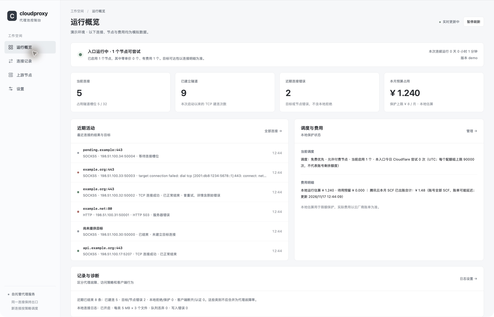
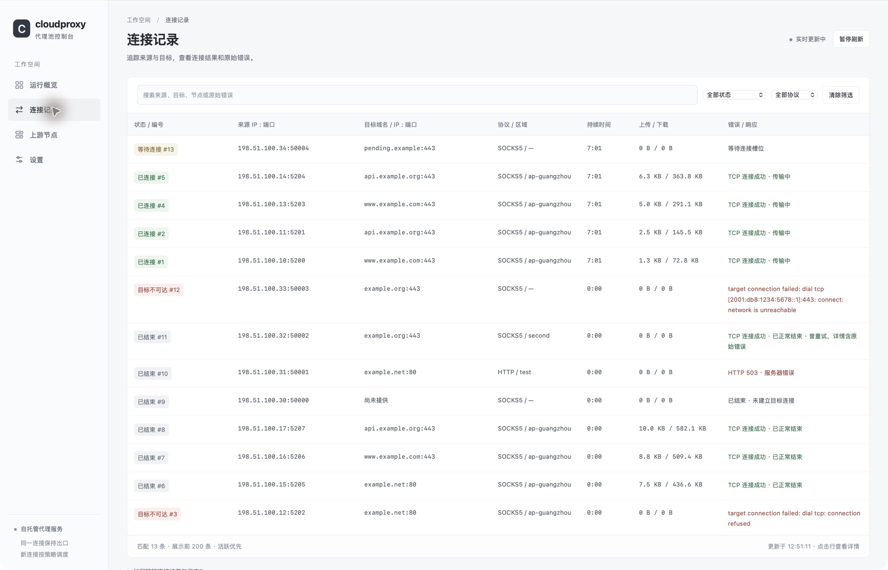
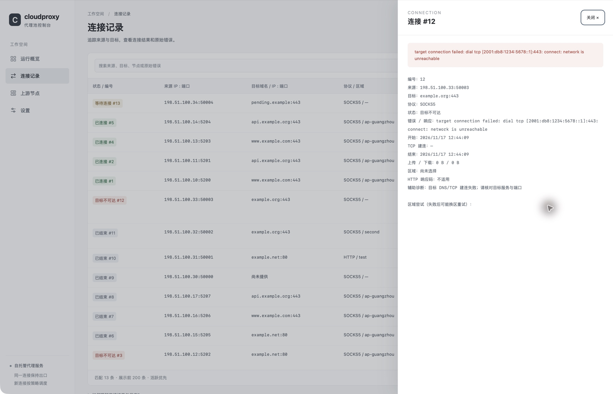
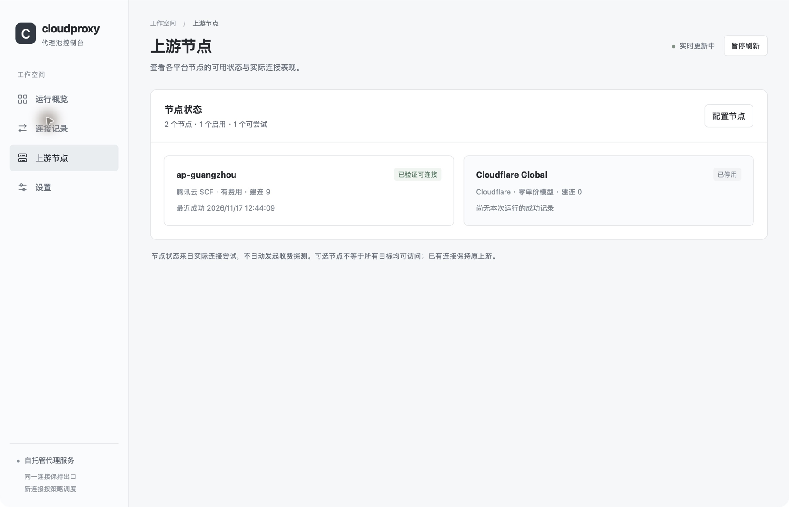
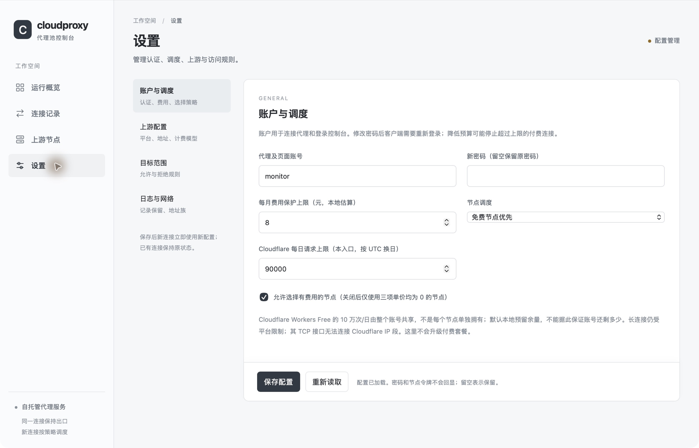
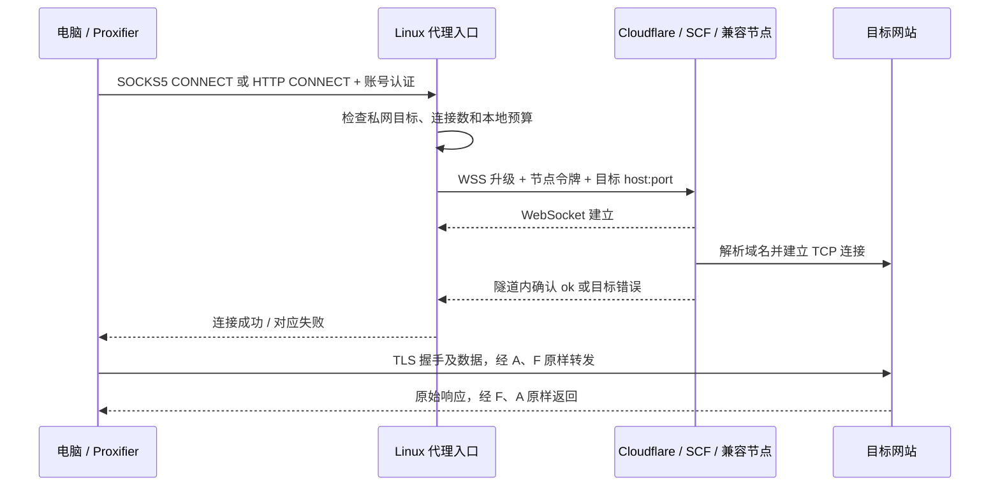

# cloudproxy

**面向长期运行、可接入多家上游的代理池服务。** 在自己的服务器上提供统一的 HTTP CONNECT、普通 HTTP 和 SOCKS5 入口，客户端只需配置一次；腾讯云 SCF、Cloudflare Workers、其他云平台或自建服务作为可替换的上游节点。

同一条 TCP 连接固定使用同一条云端连接，新连接按费用优先或轮换策略选择节点。HTTPS 保持端到端加密，无需安装私有 CA。实际公网出口由上游分配，不保证每次都不同。

**[更新记录](CHANGELOG.md) · [通用部署指南](docs/QUICKSTART.md) · [接入上游](docs/PROVIDERS.md) · [页面配置](docs/SETTINGS.md) · [运维与恢复](docs/OPERATIONS.md)**

| 能力 | 提供的行为 |
| --- | --- |
| 多上游 | 协议 2 的 WSS/TCP 接入，每节点独立令牌，明确的费用模型 |
| 连接稳定性 | 固定会话出口、失败目标退避、节点冷却、新连接最多两次尝试 |
| 可观测性 | 来源到目标、原始错误、成功记录、节点冷却/配额状态与运行时间 |
| 易配置 | 分组配置页、敏感值不回显、未保存提示、离线配置检查 |
| 易部署 | 交互配置向导、Linux amd64/arm64、systemd 安装与升级失败恢复 |
| 长期运行 | 自动重启、有界日志和队列、持久化预算/配额、无云调用的本地检查 |

本仓库由原 [CloudProxyPool](https://github.com/25smoking/CloudProxyPool) 的使用需求重新实现，项目现名为 `cloudproxy`。历史可执行文件 `scf-tunnel`、systemd 服务 `scf-tunnel-proxy`、安装目录和云资源标记继续保留兼容，升级无需改动已有账本与私有配置。项目的核心是稳定代理池，AI Agent 授权安全测试是其中一种应用。

## 阅读路线

- **第一次部署**：从[部署与首次配置](#部署与首次配置)开始，选择一个上游，再安装入口。
- **已有服务**：查看[页面配置](#页面配置逐项说明)与[客户端配置](#使用方法)。
- **理解底层**：查看[架构与原理](#架构与原理)、[调度和失败处理](#节点调度与失败处理)。
- **长期维护**：查看[日常运维](#长期运行与升级)、[故障排查](docs/TROUBLESHOOTING.md)及[更新记录](CHANGELOG.md)。

## 界面预览

以下是实际 WebUI 的本地演示截图。账号、来源地址、目标域名、节点状态和费用均为模拟数据，不包含真实部署凭据或访问记录；画面仅关闭了过渡动画并裁去浏览器工具栏。

**运行概览**：集中查看入口运行状态、连接活动、调度与费用保护。



**连接记录**：追踪来源到目标，区分正在连接、TCP 已连接、正常结束和原始错误。



<details>
<summary>查看原始错误详情、上游节点和配置页面</summary>

**错误详情**：点击连接记录，展开原始错误、连接时间与尝试过程。



**上游节点**：区分已验证可连接、尚未验证和已停用状态。



**页面配置**：在分组设置中调整认证、预算、调度、上游、目标范围与日志。



</details>

## 适合什么场景

- 为 AI Agent 的 HTTP 客户端、浏览器和支持代理的测试工具提供统一网络出口。
- 在已授权范围内进行 Web / API 行为验证，对连接失败、区域故障与费用保护分别诊断。

- 在一台自有 Linux 服务器上暴露统一代理端口，电脑只连接这台服务器。
- 新建连接时按费用优先或轮换策略选择多个上游，已有连接不随请求切换出口。
- 保持浏览器与目标网站的端到端 TLS，使用网站真实证书。
- 为个人低流量使用设置本地费用估算保护，并查看连接错误原因。

它有明确的吞吐、时长和并发边界，**不是无限带宽、无限时长、永久免费或固定 IP 的代理服务**。只应代理你有权访问的目标。

## 在 AI Agent 渗透测试工作流中的位置

```text
授权范围 / 测试任务
        ↓
AI Agent → 执行器（目标校验、任务限速、测试证据）
        ↓ HTTP CONNECT / SOCKS5
cloudproxy → Cloudflare / 腾讯云 / 兼容 WSS 节点 → 已授权目标
```

项目承担网络传输层；任务规划、漏洞判断、测试授权和证据整理由 Agent 与执行器完成。代理凭据应放在执行器的 Secret/环境变量中，不写入 Agent 提示词、聊天记录、任务报告或命令回显。

| Agent 使用方式 | 接入点 | 需要注意 |
|---|---|---|
| curl、HTTP/API 客户端 | HTTP 代理 `10800` | HTTPS 使用 CONNECT，保留网站证书验证 |
| 浏览器或由 Proxifier 接管的工具 | SOCKS5 `10801` 或 CONNECT `10800` | 应用后台连接也占用配额，内网走 Direct |
| 支持代理的 TCP 连接测试 | SOCKS5 TCP CONNECT | 工具必须支持相应代理协议；原始包、SYN 扫描和 UDP 不通过此隧道 |

**授权范围与目标限速应由执行器明确执行。** 入口支持目标允许/拒绝和端口范围配置，但不判断测试授权；执行器仍需限定授权任务和速率。WebSocket 分片节奏也不等于对目标网站的 HTTP QPS 限速。

Agent 并行任务数量不等于 TCP 连接数。建议从低并发验证连接和费用开始，复用会话可减少建连开销；连接复用同时意味着不会按每个 HTTP 请求轮换出口。不要把多区域出口用于规避目标方规定的测试速率或范围。

代理为共享入口，没有按 Agent/任务隔离的配额、账本或完整测试审计。不同任务需要独立隔离时，应分别部署入口并使用独立配置与账本。

[完整 AI Agent 接入示例与执行器约束](docs/AI_AGENT.md)

## 架构与原理



电脑到入口是常规 HTTP/SOCKS5；入口到所选云节点是 WSS；云节点到目标是 TCP。HTTPS 的 TLS 连接端点仍然是**电脑与目标网站**。WSS 是另一层传输保护，不替换网站证书。

这里的“HTTP/HTTPS 代理”通常指 HTTP CONNECT：代理地址可以是 `http://服务器:10800`，也可以用于访问 HTTPS 网站。**入口本身目前没有 TLS 服务端监听功能**，不应将它直接填成 `https://服务器:10800`。

### 为什么一条连接不能中途换 IP

目标网站的 TCP 会话依赖网络端点。连接建立后更换云端连接或出口会破坏会话，因此本实现不对已建立连接做迁移或自动重放。HTTP keep-alive、HTTP/2 会复用 TCP 连接，也就继续使用同一出口；刷新网页不一定换 IP。

增加同一区域的函数数量不等于增加独立出口 IP。本项目轮询的是函数节点，不维护可指定的固定公网 IP 清单。

### 为什么先建立 WSS，再连接目标

SCF 可能把 WebSocket 升级前的业务错误改写为 500/430“握手失败”。如果据此暂停整个区域，一个无法连接的目标就会影响其他网站。

当前协议使用 `X-Tunnel-Protocol: 2`：先完成认证 WSS，再在隧道内发送 `{"ok":true}` 或目标错误。**目标失败与节点故障分开统计**；同一失败目标短暂退避，不暂停整个区域。详见 [协议与故障机制](docs/ARCHITECTURE.md)。

### 节点调度与失败处理

一次代理连接经历以下步骤：

1. **认证与范围校验**：校验入口账号，读取目标域名或 IP、端口，检查允许/拒绝规则。私网、回环和保留地址在本地拒绝。
2. **取得资源**：检查并发槽位、月预算、平台每日限额、节点停用/冷却及目标退避状态。排队和拒绝同样记录在监控页。
3. **选择节点**：`free_first` 优先选三项单价都为零的节点；`round_robin` 在符合条件的节点间轮换。禁用付费回退后，新连接只能选择免费节点。
4. **确认目标可达**：建立 WSS、通过节点令牌认证，再等待云端目标 TCP 建连结果。只有收到成功确认，才向客户端报告代理建连成功。
5. **固定转发**：二进制帧携带原始 TCP 字节，支持单向 EOF；不解密 HTTPS，不重新执行已经发送的应用请求。
6. **结束与结算**：对关闭、超时、限额或错误记录结果，更新本地费用与节点状态，释放 socket、队列槽位和预留。

建连阶段每次最多尝试两个节点，具体是否回退取决于错误类型、平台和费用策略。节点故障会影响节点健康；目标 DNS/TCP 失败按目标及故障范围退避，避免一个坏目标拖累整个池。免费路径目标失败可尝试另一故障范围，付费路径目标失败不无限跨区域重试。成功转发后的连接断开交给客户端重连。

**轮换单位是新 TCP 连接，不是网页刷新、HTTP 请求或固定公网 IP。** 平台可能让不同节点共享出口；同一连接存活期间保持原隧道，但连接重建后平台可能分配不同出口。

### 三种凭据分别在哪里使用

| 凭据 | 使用位置 | 是否交给客户端 / 页面 |
| --- | --- | --- |
| 代理账号与密码 | 电脑 → 入口；浏览器 → 管理面板 | 客户端需要；页面与代理共用账号 |
| 节点令牌 | 入口 → 云端隧道 | 仅入口私有配置和云端环境；保存后页面不回显 |
| 腾讯云密钥 / Cloudflare API Token | 部署工具 → 云平台管理 API | 不写入客户端，不交给入口代理进程 |

云平台 API Token 不能当节点令牌使用。节点地址必须是已经部署了本项目协议的 WSS 地址，不是随便一个云函数 HTTP URL。

## 当前默认限制

| 项目 | 默认值 / 行为 |
|---|---|
| HTTP / CONNECT | `10800`，必须账号认证 |
| SOCKS5 | `10801`，必须用户名/密码认证 |
| 监控 | `127.0.0.1:8081`，仅本机 |
| 同时建连或活跃隧道 | 32，可配置 1–64；突发最多排队 5 秒 |
| 单连接最长时长 | 7200 秒（2 小时） |
| 空闲关闭 | 120 秒（2 分钟） |
| 单连接累计流量 | 上下行合计 128 MiB |
| 数据分片与节奏 | 16 KiB，写入间隔至少 150ms；单方向约 100 KiB/s |
| 新连接故障切换 | 每次建连最多 2 个节点；免费上游目标失败可回退；成功后不迁移连接 |
| 区域冷却 | 节点故障连续 3 次，冷却 30 秒 |
| 失败目标退避 | 同一未知目标仅一次探测；目标失败按地址退避 30 秒至 10 分钟 |
| 私网 / 回环目标 | 拒绝；应在电脑上配置 Direct |
| UDP | 不支持 SOCKS5 UDP ASSOCIATE；不支持 QUIC 等 UDP 流量 |

时长、流量和平台限制仍会断开连接，客户端需要重连；进程自动恢复也不能无损恢复原 TCP 会话。速度还取决于网络、冷启动、SCF 配额和目标网站。

## 部署与首次配置

整体顺序：**下载构建 → 部署至少一个上游 → 生成入口配置 → 安装服务 → 登录页面 → 验证客户端**。只装入口而没有可用上游，无法访问目标。

### 1. 下载并构建

准备 Go **1.26.5 或更高兼容版本**、Python **3.11+**、Git。入口安装脚本适用于带 systemd 的 Linux amd64 / arm64。可以在开发电脑交叉编译，但生成的 Linux 程序只能在相应架构的 Linux 上运行。

```bash
git clone https://github.com/f0raway/cloudproxy.git
cd cloudproxy
bash ops/build.sh
# ARM64 入口改为：bash ops/build.sh arm64
```

默认产物为 `dist/scf-tunnel-linux-amd64`。下面安装命令按 amd64 编写；ARM64 请替换产物名。腾讯云部署包使用 amd64，不能拿 ARM64 入口产物上传。

### 2. 选择并部署上游

| 选择 | 适用条件 | 下一步 |
| --- | --- | --- |
| Cloudflare Workers Free | 入口能访问 Worker 地址，目标符合平台 TCP 限制 | 按下方 Cloudflare 步骤部署 |
| 腾讯云 SCF | 需要大陆区域上游，接受按实际用量收费 | 按[腾讯云部署详解](#腾讯云部署详解)部署，使用生成的 `runtime/agent.json` |
| 其他平台 / 自建节点 | 支持长 WebSocket、目标 DNS 与原始 TCP 出站 | 按[通用节点协议](docs/PROVIDERS.md)部署，再运行配置向导 |

可以先接入一个上游完成验收，再在页面添加其他节点。部署工具不会替你自动购买未指定平台的资源。

#### Cloudflare：创建凭据并部署

1. 登录 Cloudflare，在 **My Profile → API Tokens** 创建自定义 API Token，给目标账号 **Account → Workers Scripts → Edit** 权限；不要使用 Global API Key。workers.dev 部署不需要修改 DNS 的权限。
2. 进入 **Workers & Pages** 的账号信息复制 **Account ID**，它不是 API Token 的 ID。界面位置变化时参考[官方查找说明](https://developers.cloudflare.com/fundamentals/account/find-account-and-zone-ids/)。
3. 在可信部署机器创建仓库外的私有文件：

```bash
install -d -m 700 "$HOME/.config/cloudproxy"
install -m 600 config/cloudflare.toml.example "$HOME/.config/cloudproxy/cloudflare.toml"
# 使用你熟悉的编辑器填写下面两个字段；不要提交真实文件。
```

```toml
[cloudflare]
account_id = "YOUR_ACCOUNT_ID"
api_token = "YOUR_API_TOKEN"
worker_name = "cloud-tunnel-proxy"
```

先检查打包，再部署（第二条命令会实际创建或更新 Worker）：

```bash
python3 deploy/cloudflare.py --dry-run
python3 deploy/cloudflare.py \
  --credentials "$HOME/.config/cloudproxy/cloudflare.toml" --no-register
```

凭据文件旁会生成两个私有文件：`cloudflare-node-token` 保存节点令牌；`cloudflare-node.json` 保存 `url`、`token`、`provider`、`quota_group`。权限均为 600。**下一步配置向导中填写的是这里的节点 URL 和 token，不能填管理 API Token。** 不要把文件内容贴到公开 Issue 或终端共享记录中。

若入口网络无法访问 workers.dev，可在 Cloudflare 给该 Worker 绑定已有域名的独立子域名，再设置 `custom_domain = "proxy.example.com"`。部署器会核对现有绑定，不代替创建绑定；不要覆盖其他网站正在使用的子域名。详细权限、绑定与网络检查见 [Cloudflare 部署指南](docs/CLOUDFLARE.md)。

#### 其他平台：先验证协议能力

可运行本仓库 Go 程序的 `-node` 模式；节点读取 `CLOUD_PROXY_TOKEN`，监听 `PORT`（默认 9000）。平台前端需要提供可信 TLS 证书、WebSocket 升级及足够长的超时。容器构建入口：

```bash
docker build -f workers/Dockerfile -t cloudproxy-node .
```

将镜像部署到选定平台，通过平台的 Secret 配置节点令牌，将服务端口映射到公开 WSS 域名。容器自身没有 TLS 证书管理；TLS 由平台入口或你自己的反向代理提供。配置 `provider=custom`，明确填写计算、流量和调用单价。完整契约见 [上游接入](docs/PROVIDERS.md)。

### 3. 生成入口私有配置

Cloudflare 或通用节点使用离线向导；腾讯云自动部署已生成 `runtime/agent.json` 时，直接使用该文件，不必重复生成。

```bash
python3 ops/configure.py --output config/agent.json
```

依次输入：平台类型、WSS 地址、节点令牌、入口账号、入口密码、月度费用保护上限。通用节点还需填写三项单价。向导不创建云资源、不访问节点，不覆盖已有文件；密码和令牌不回显，输出权限 600。

第一次使用同一 Cloudflare 账号的多个节点时，在页面给这些节点填入同一个 `quota_group`（部署状态文件已给出）；默认未填组名的 Cloudflare 节点会共同使用默认组。不要通过多个节点重复计算账号免费额度。

### 4. 安装到 Linux 入口服务器

如果在其他电脑构建，安全复制程序、`ops/` 与私有配置到 Linux，再在仓库目录执行：

```bash
./dist/scf-tunnel-linux-amd64 -check -config config/agent.json
sudo bash ops/install.sh dist/scf-tunnel-linux-amd64 config/agent.json
sudo systemctl status scf-tunnel-proxy --no-pager
```

`-check` 只读检查有效配置，不发云请求，也不证明目标可达。安装器创建低权限服务用户、开机自启和本地健康检查，默认把配置安装到 `/etc/scf-tunnel-proxy/agent.json`。默认开放监听 HTTP `10800`、SOCKS5 `10801`；防火墙不会被脚本修改，请只允许可信内网、VPN 或指定来源访问。

### 5. 打开管理页面

默认面板仅监听服务器的 `127.0.0.1:8081`。在自己的电脑执行：

```bash
ssh -N -L 18081:127.0.0.1:8081 your-user@your-server
```

保持 SSH 连接，浏览器访问 `http://127.0.0.1:18081`，使用向导设置的**代理账号密码**登录。这里的 `your-user` 是服务器 SSH 用户，与代理账号无关。已有历史部署的路径、服务名、监听地址可能不同，先参考[现有部署迁移](docs/EXISTING_DEPLOYMENT.md)。

### 6. 完成第一次验收

先按[使用方法](#使用方法)配置 curl 或 Proxifier，再在“连接记录”确认出现自己的来源和目标、TCP 建连成功、上下行数据。访问 HTTPS 成功时应验证目标网站真实证书；随后测试一个不可达目标，确认原始错误可见且其他目标仍可用。只有进程运行或节点“可尝试”，还不能视作转发验证通过。

## 腾讯云部署详解

### 1. 准备环境并构建

需要 Go **1.26.5 或更高兼容版本**、Python **3.11+**。服务端安装脚本面向有 systemd 的 **Linux amd64 / arm64**，依赖 `python3` 及常规系统工具。推荐使用仍受支持的 Ubuntu LTS。

```bash
git clone https://github.com/f0raway/cloudproxy.git
cd cloudproxy
bash ops/build.sh
```

生成 `dist/scf-tunnel-linux-amd64`。默认输出 amd64；ARM64 使用 `bash ops/build.sh arm64`。同一个程序通过 `-node` 运行兼容上游，通过 `-config` 运行入口代理，`-check` 只读校验实际配置，`-version` 查看版本。无需在 SCF 中安装 Go 或 Python 第三方库。

### 2. 准备腾讯云部署配置

```bash
python3 -m venv .venv
.venv/bin/pip install -r deploy/requirements.txt
cp config/deploy.toml.example config/deploy.toml
chmod 600 config/deploy.toml
```

编辑 `config/deploy.toml`。默认区域为上海、广州、北京、成都、南京，不包含境外区域。区域是否对账号开放、是否有配额，以腾讯云实时结果为准。

以下交互命令按 Bash 编写（macOS 的 zsh 请先运行 `bash`）。通过环境变量提供凭据，或在**本地私有配置**的 `[tencent]` 段填写。不要提交真实值。以下交互读取不会把密钥写进命令历史：

```bash
read -r -p 'Tencent SecretId: ' TENCENTCLOUD_SECRET_ID
read -r -s -p 'Tencent SecretKey: ' TENCENTCLOUD_SECRET_KEY
printf '\n'
export TENCENTCLOUD_SECRET_ID TENCENTCLOUD_SECRET_KEY
```

临时凭据还应设置 `TENCENTCLOUD_SESSION_TOKEN`。账号需要开通 SCF 并具备相应函数创建、查询、代码更新和函数 URL 触发器管理权限。

先预览，不创建资源、不写令牌、不调用云 API：

```bash
.venv/bin/python deploy/deploy.py --dry-run
```

### 3. 部署云函数

**下一条命令会创建实际腾讯云资源，运行和出网可能产生费用。**

```bash
.venv/bin/python deploy/deploy.py
```

部署工具：

1. 打包 Linux 程序和可执行 `scf_bootstrap`。
2. 创建 128MB、7200 秒超时、120 秒空闲超时的 WebSocket Web 函数。
3. 使用 Python3.9 作为平台基础运行环境，通过启动脚本执行静态 Go 程序并监听 `9000`。
4. 创建函数 URL，生成本次部署使用的节点访问令牌；不启用固定出口 IP、NAT 网关或预置并发。
5. 保存节点清单与代理配置；只打印区域状态，不打印密钥、令牌或密码。

默认私有输出：

```text
runtime/deploy/node-token                 # 节点令牌，必须保留
runtime/deploy/deployment-results.json    # 节点清单 / 部署错误
runtime/agent.json                       # 随机代理密码、节点令牌与运行配置
```

这些文件权限为 `600`，已被 Git 忽略。部分区域失败时保留诊断结果，**不覆盖已有代理配置**；已创建的云资源不会自动删除。

部署成功只表示资源创建成功，**还需实际转发验证**，不能把控制台 Active 等同于业务可用。

### 4. 在 Linux 入口服务器安装

将二进制、`ops/` 和私有 `runtime/agent.json` 安全复制到入口服务器。如果在入口服务器上完成上述步骤，可以直接执行：

```bash
sudo bash ops/install.sh dist/scf-tunnel-linux-amd64 runtime/agent.json
sudo systemctl status scf-tunnel-proxy --no-pager
```

默认监听所有网卡的两个代理端口。安装脚本**不更改防火墙**，请按实际需要只向可信内网 / VPN / 指定客户端开放 `10800`、`10801`，不要公开监控端口。

脚本安装独立低权限用户、开机自启、异常重启、每两分钟本地健康检查、日志轮转和内存限制。代理进程不需要腾讯云管理密钥。具体见 [运维说明](docs/OPERATIONS.md)。

已有运行环境请先阅读 [现有部署保存与迁移](docs/EXISTING_DEPLOYMENT.md)，不要让两个服务争用端口或同时写一个费用账本。

## 使用方法

从私有 `runtime/agent.json` 或 `/etc/scf-tunnel-proxy/agent.json` 读取 `user`、`password`。**代理密码和腾讯云密钥是两套不同的凭据。**

以下命令使用 Bash 与文档示例 IP `203.0.113.10`，请替换成实际入口服务器。交互读取密码后测试，不需要 `-k` 或 `--cacert`：

```bash
read -r -p 'Proxy username: ' PROXY_USER
read -r -s -p 'Proxy password: ' PROXY_PASSWORD
printf '\n'

curl --noproxy '' --proxy-user "$PROXY_USER:$PROXY_PASSWORD" \
  -x http://203.0.113.10:10800 http://myip.ipip.net

curl --noproxy '' --proxy-user "$PROXY_USER:$PROXY_PASSWORD" \
  -x http://203.0.113.10:10800 https://myip.ipip.net

curl --noproxy '' --proxy-user "$PROXY_USER:$PROXY_PASSWORD" \
  -x socks5h://203.0.113.10:10801 https://myip.ipip.net
```

测试完成后运行 `unset PROXY_USER PROXY_PASSWORD` 清理当前 shell 变量。

`SOCKS5h` 将域名交给云端解析；客户端也可发送目标 IP。HTTPS 应看到目标网站真实证书。

### Proxifier

在 `Profile → Proxy Servers` 添加：

- Address：入口服务器 IP；Port：`10801`；Protocol：`SOCKS Version 5`。
- 启用 `Authentication`，填写代理账号密码，然后运行 `Check`。
- 若使用 `10800`，Proxifier 的协议应选 **HTTPS（CONNECT）**，不是只支持普通 HTTP 的选项。
- 使用 Proxifier 统一接管时，应用内不要再配置同一个代理，避免重复代理。

在 `Profile → Proxification Rules` 添加“内网直连”，放在代理规则前：

```text
Applications: Any
Target hosts: 192.168.0.0/16; 10.0.0.0/8; 172.16.0.0/12
Target ports: Any
Action: Direct
```

保留 Localhost 直连规则。云函数无法替电脑访问电脑所在的内网，私网目标显示不可达不等于代理服务离线。[官方代理设置](https://www.proxifier.com/docs/win-v4/proxy.html) · [官方规则说明](https://www.proxifier.com/docs/win-v4/rules.html)

## 多平台节点与页面配置

控制台左侧分为 **运行概览、连接记录、上游节点、设置** 四个工作区，采用浅灰与白色界面。概览展示近期活动；连接记录支持搜索、状态/协议筛选和暂停刷新，点击记录从右侧查看结果、原始错误与重试详情。

**设置** 按账户与调度、上游配置、目标范围、日志与网络分组。切换页面保留未保存修改，保存时自动定位有误字段。可以修改代理/页面账号密码、月预算、目标允许/拒绝规则、端口范围、节点启停、节点地址/令牌和单价，并设置“免费优先/轮换”“允许付费回退”与 Cloudflare 本地每日限额。保存即时生效；连接本身继续保持原节点，降低预算触发费用保护除外。密码/节点令牌不回显，留空保留。

运行配置覆盖文件自动保存在费用账本旁的 `settings.json`（600），可用 `settings_path` 指定。健康检查会读取覆盖后的账号，避免改密码后误重启。页面管理与代理共用一个账号，只应交给可信管理者。入口地址、账本路径及云平台管理凭据不通过网页下发。

- **腾讯云 SCF**：兼容已有节点，保留大陆区域、128MB 模型与全局月预算。
- **Cloudflare Workers Free**：独立 Worker 适配，不按腾讯云时长计费；本地默认每日 90,000 次尝试，UTC 换日、同配额组共享，落盘后重启不重置。100,000 次是官方账号级免费请求额度，不是每个 Worker 独享；直接访问 Worker 等本入口之外的请求不在本地计数内。
- **其他平台**：可接入实现协议 2 的 WSS 节点，必须填写自己的费用模型。提供通用 Go 容器节点及 `PORT` 支持；不宣称所有云函数都支持原始 TCP/WebSocket，也不会替你开通未指定的平台。

Cloudflare TCP 接口限制 Cloudflare IP、私网地址及端口 25；返回平台能力限制时可回退至符合费用策略的其他节点，并按目标缓存该平台限制 10 分钟。已有连接不重放应用数据。`workers.dev` 在部分网络不可达，部署成功不等于转发可用；应验证 DNS、TLS、TCP 转发，必要时使用自有域名，验证前停用该节点。

零单价节点报告目标 DNS/TCP 错误时，可尝试另一个故障范围的节点（每次建连总计最多两次尝试）；关闭付费节点时仍可选择其他免费上游。失败范围对该目标按 30 秒至 10 分钟退避，其他范围的成功不清除它的计数。付费节点的目标错误不继续跨区重试；平台明确不支持目标时缓存 10 分钟。通用节点按端点主机隔离故障，腾讯云和 Cloudflare 各使用自己的平台范围。

[Cloudflare 部署与权限](docs/CLOUDFLARE.md) · [页面配置与目标范围](docs/SETTINGS.md) · [官方免费额度](https://developers.cloudflare.com/workers/platform/pricing/) · [TCP 限制](https://developers.cloudflare.com/workers/runtime-apis/tcp-sockets/)

## 页面配置逐项说明

打开左侧 **设置**，按分组编辑，完成后点击保存。配置在服务端整体校验后写入私有覆盖文件；失败时保留原配置。切换工作区保留未保存的编辑，离开页面会提示。

| 分组 / 配置 | 如何填写 | 生效与注意事项 |
| --- | --- | --- |
| 账户与调度 · 用户名、密码 | 设置自己的代理管理账号；密码至少 8 字节 | 保存后客户端同步更新认证；密码留空保留，页面不回显 |
| 月度保护上限 | 人民币金额；例如目标 10 元时预留余量设为 8 元 | 全部付费节点共用；本地估算不等于云账单精确封顶 |
| 调度策略 | 免费优先或轮换 | 仅影响新连接；轮换仍受节点健康、配额、预算约束 |
| 允许付费回退 | 接受费用时开启 | 关闭后新连接只能使用零单价节点，已有付费连接不被主动迁移 |
| Cloudflare 每日限额 | 默认 90,000；0 表示停止新建 Cloudflare 连接 | 本地按 UTC 换日、失败尝试也计数；不是云账号剩余额度 |
| 上游配置 · 平台、名称、地址 | 选实际适配类型；使用 `wss://主机/tunnel` | 名称便于辨认；只填 URL 不能部署云函数 |
| 节点令牌 | 填部署时生成的节点 token | 已保存的同 URL 节点留空保留；新增 URL 应明确填令牌 |
| 费用单价 | 元/连接秒、元/GB、元/次 | 通用节点必须明确填写；填 0 不会让收费平台免单 |
| 配额组 | 同一 Cloudflare 账号所有节点用同组 | 多入口仍需自行分摊账号额度；本地文件不跨主机同步 |
| 目标范围 | 域名、通配子域名、IP/CIDR；端口单独填写 | 拒绝优先；允许留空表示不额外缩小公网范围 |
| 日志与网络 | 连接日志开关、单文件大小、备份数量、上游地址族 | IPv4/IPv6 选择影响入口连接节点；不改变目标规则 |

目标范围示例：允许 `example.com` 与 `*.example.com`，拒绝 `admin.example.com`，端口只允许 `80` 和 `443`。`*.example.com` 不包含根域名；不要填 URL 路径。IP/CIDR 规则只匹配客户端直接提交的 IP，不在入口提前解析域名。私网与 Fake-IP 始终拒绝，应让客户端传真实域名或对内网使用 Direct。

并发上限 `max_connections`（默认 32，可设 1–64）、入口监听地址、账本路径、账单缓存路径和云平台管理密钥不在页面编辑；并发与监听等基础参数修改后需重启服务。页面覆盖优先于基础配置的对应可编辑字段；手改基础文件前需检查 `settings.json`，否则看起来会像修改没有生效。详细字段与接口见 [设置说明](docs/SETTINGS.md)。

## 费用保护

默认本地月阈值为 **8 元**，可作为 10 元目标预算的余量策略；**它不是腾讯云账单的精确封顶，也不保证长期免费**。

- 本地模型使用 128MB、`0.00011108 元/GB·秒`、`0.0133 元/万次`、`0.80 元/GB` 的参考价格。
- 活跃隧道的计算参考成本约 **0.05 元/连接小时**，流量、初始化及其他适用费用另计。
- 取消每次固定追加 3 秒；初始只预留约 30 秒计算和 256 KiB 流量；数据传输及每 5 秒检查推动小额补足。
- 预留接近耗尽且无法补足时停止该隧道；余额不足也拒绝新连接。费用账本采用文件持久保存，正常退出会结算。
- 自然月按北京时间切换；跨月活跃连接保守继续计入估算。不要通过删除账本“恢复额度”。

估算含保守流量系数，依据连接时长、调用次数与转发字节本地计算，不直接使用云账单扣减。可选账单同步每小时读取腾讯云账号 SCF 出账缓存，存在延迟，且可能包括其他 SCF 函数。估算不涵盖账号其他服务、绕过入口直接访问云 URL 的请求、全部日志费用等。价格、折扣、免费试用和计量以腾讯云实际账户为准。部署脚本固定 128MB，不能随意提高云函数内存而继续使用原费用模型。

[官方定价](https://cloud.tencent.com.cn/document/product/583/12281) · [免费试用](https://cloud.tencent.com/document/product/583/12282)

版本 2 会对当前月旧账本中“每次固定 3 秒”的余量执行一次校正，保留 `legacy_estimated_yuan` 与 `legacy_fixed_allowance_removed_yuan` 审计字段；不清空调用次数/流量，不改变预算上限。这是本地估算校正，不是云账单退款。旧账本中的其他保守预留仍然保留。

入口先拦截非公网/保留 IP，失败目标先单次探测、再指数退避，避免客户端反复重试引发重复云调用。连接保持原节点与独立 TCP；不会重放已发送的数据。预算无法补足、空闲、时长和流量达到上限时仍会关闭隧道。

## 监控、日志与排查

```bash
curl --user YOUR_PROXY_USER -s http://127.0.0.1:8081/api/stats
sudo tail -100 /var/lib/scf-tunnel-proxy/service.log
sudo systemctl status scf-tunnel-proxy --no-pager
```

监控页每 2 秒更新；费用区分本地运行估算、待用预留、历史校正和可选的腾讯云 SCF 账号出账合计。云账单每小时只读同步、可能延迟且包含账号下其他 SCF，不直接作为入口预算扣减依据。配置见 [成本优化与账单接入](docs/COSTS.md)。

连接明细包括：

- **来源 → 目标**：来源 IP/端口、目标域名或 IP/端口、SOCKS5 / CONNECT / HTTP 协议与所选区域。
- **逐条状态**：握手/认证、等待、连接中、TCP 已连接、已结束、失败；显示持续时间和双向流量。
- **错误 / 响应**：直接显示脱敏原始错误并换行；无错误时明确标注 TCP 连接成功、正常结束、等待连接或实际 HTTP 响应码。点击行查看每次重试的原始错误与辅助诊断。
- **筛选与排查**：来源/目标/错误搜索、协议与状态筛选、暂停刷新；接口中断时明确标记旧数据。
- **历史记录**：内存保留最近 1,000 条结束记录，活跃记录单独保留；开启本地连接日志后，重启可从保留文件恢复近期结束记录。单页显示筛选后的前 200 条。

页面及两个接口均使用**现有代理账号和密码**进行 HTTP Basic 登录。上面的 curl 会提示输入密码；不要把密码直接写入命令历史。默认只监听回环地址，推荐通过 SSH 隧道访问。升级时请同时更新 `ops/watchdog.py`，旧版无认证的健康检查会收到 401。

服务器无法读取客户端的进程名；来源经过 NAT 后可能相同。**已连接表示目标 TCP 建连成功，不保证 TLS 或网站业务成功**；HTTP 响应码另行展示，HTTP 4xx/5xx 不冒充代理网络失败。普通 HTTP 按请求记录（正文流量），即使复用隧道也各自保留来源；SOCKS5 / CONNECT 按 TCP 连接记录（隧道流量）。不记录路径、查询参数、请求正文或认证信息。[监控机制与升级说明](docs/MONITORING.md)

需要在电脑查看面板时使用 SSH 隧道：

```bash
ssh -L 18081:127.0.0.1:8081 your-user@your-server
```

随后访问 `http://127.0.0.1:18081`，使用代理账号密码登录。[错误码与排查步骤](docs/TROUBLESHOOTING.md)

连接日志与运行日志各自按文件大小轮转（默认 5 MiB × 3，两类合计约 30 MiB），配置页可调整。页面将本地拒绝/退避、客户端认证/断开与目标/节点错误分别统计，避免把 Fake-IP 拒绝率当成系统故障率。日志失败或队列丢弃会显示计数。服务器到云节点还可选自动、仅 IPv4、仅 IPv6；这不会改变客户端目标范围。[日志与诊断说明](docs/LOGGING.md)

## 长期运行与升级

安装器提供开机自启、进程异常恢复、本地健康检查以及有上限的日志。健康检查不调用收费云隧道；上游暂时不可达不会单凭这一点触发反复重启。它仍是单入口服务，不能提供无中断升级、跨机器会话迁移或可用性 SLA。

升级前备份基础配置、`settings.json`、`usage.json`、`provider-daily-usage.json`、旧程序及部署节点令牌。使用新版本检查有效配置，再按[运维说明](docs/OPERATIONS.md)安装。升级重启会断开已有连接，客户端需要重连；费用和配额文件必须保留。不要让多个入口同时写同一份账本。

| 现象 | 先看哪里 | 常见解释 |
| --- | --- | --- |
| 面板能打开，代理不通 | 连接记录的最终错误与上游状态 | 面板只证明入口运行，不证明上游或目标可达 |
| Proxifier 认证失败 | 10801 条目的认证设置 | 需要启用用户名/密码；使用代理账号而非 SSH 账号 |
| `198.18.x.x` 被拒绝 | 客户端 DNS / Clash Fake-IP 模式 | 云端没有客户端的映射表；改为代理侧解析域名 |
| workers.dev DNS/TLS 失败 | 入口服务器到 Worker 的网络 | 检查 DNS 与路径，必要时绑定自有域名；不能靠关闭证书验证解决 |
| TCP 已连接但网站仍报错 | 客户端 TLS/HTTP 结果、双向流量 | 建连成功不是业务成功；HTTPS 正文对代理不可见 |
| 月预算或日配额不足 | 费用区域、配额组、云平台账单 | 保留账本，调整真实预算/流量；重启不应恢复额度 |

详见 [错误排查](docs/TROUBLESHOOTING.md)、[成本与账单](docs/COSTS.md)、[日志保留](docs/LOGGING.md)。

## 开发与验证

```bash
go test -race -timeout 90s ./...
go vet ./...
python3 -m unittest discover -s deploy -p 'test_*.py' -v
python3 -m unittest discover -s ops -p 'test_*.py' -v
node --test workers/cloudflare/bridge.test.mjs tests/*.test.cjs
python3 deploy/cloudflare.py --dry-run
bash -n ops/build.sh ops/install.sh
bash ops/build.sh
```

Go 测试覆盖 TLS 证书透传与连接复用、SOCKS5 认证、二进制流与半关闭、目标错误分类、私网拒绝、失败目标退避、账本持久化/跨月、滚动预算及正常停止结算；新增监控测试覆盖来源归属、流量、认证失败、错误尝试、HTTP 复用、有界历史、并发快照和敏感值脱敏。Python 测试覆盖打包格式/可执行权限、私有文件权限、配置生成与升级保留。

此次实现的现场版本验证过五个大陆区域、连续网页请求、混入错误目标的并发以及 32 条同时 TCP 连接，并得到用户 Proxifier Checker 通过的反馈。这是当时环境的证据，**不能代表所有账号、目标或网络条件均已验证**。仓库通用安装脚本仍需在自己的目标系统验收。

## 文件结构

```text
agent.go             入口代理、认证、区域调度、故障分类与退出结算
node.go              SCF WSS 服务、目标 DNS/TCP 连接和状态确认
stream.go            字节流封装、分片、速率、半关闭和时长/流量限制
monitor.go           有界连接记录、认证监控接口、来源与目标归属
settings.go / settings.js  私密配置覆盖、即时应用和管理页面
providers.go         多平台费率、每日配额与免费优先调度
target_policy.go     非公网拦截、单次探测和指数退避
billing.go           可选云账单缓存读取
dashboard.html       内嵌控制台结构
dashboard.js / .css   运行概览、连接明细与样式
config.go            实际配置的只读校验
meter.go             小额滚动预留及持久费用估算
main.go              同一程序的入口 / 云节点两种模式
tunnel_test.go       核心回归与并发测试
config/*.example     无真实凭据的配置模板
deploy/              腾讯云资源创建和代码更新工具
ops/                 构建、systemd 安装、本地健康检查
docs/                机制、运维、排查与旧部署迁移说明
```

## 安全边界与依赖

公开前已检查完整 Git 历史、当前修改和自动检查日志；检查范围与后续维护方法见 [敏感信息检查说明](docs/SECURITY.md)。

入口 HTTP Basic / SOCKS5 用户名密码本身不加密，应使用可信内网或 VPN。HTTPS 内容仍由客户端与网站 TLS 保护；普通 HTTP 的明文内容不具备这种保护。入口与云节点通过正常校验服务证书的 WSS 连接。

函数 URL 使用 `AuthType=NONE`，应用层另校验随机节点令牌；未授权请求仍可能触发平台调用计费。不要公布节点 URL 和令牌，定期核对云账单。代码不抓取或保存 HTTPS 正文；错误日志会包含目标主机/端口等连接元数据。

依赖为 Gorilla WebSocket、go-socks5 和 Go x/net，相关许可证见 [THIRD_PARTY_NOTICES](THIRD_PARTY_NOTICES.md)。仓库暂未选择原创代码的开源许可证。

## 官方参考

- [SCF WebSocket 协议支持与平台限制](https://cloud.tencent.com/document/product/583/63406/)
- [创建 SCF 函数](https://cloud.tencent.com/document/api/583/18586)
- [SCF 函数网络与出口模式](https://cloud.tencent.com/document/product/583/123457)
